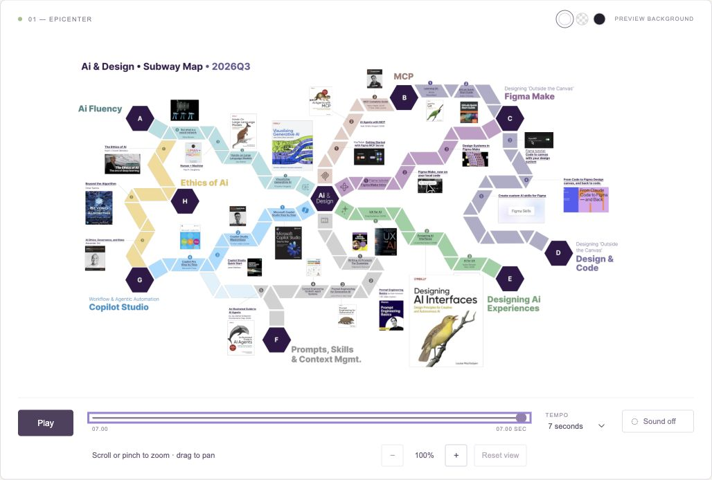

# Unfold — AI & Design origami studies

Three.js motion studies of the AI & Design subway map, with transparent backgrounds, optional paper sounds, drag-to-pan, and wheel/pinch zoom.

## Run locally

From this project folder, start a static server:

```bash
python3 -m http.server 8000 --bind 127.0.0.1
```

Open [the comparison viewer](http://127.0.0.1:8000/) or [the transparent overlay](http://127.0.0.1:8000/overlay.html). The runtime needs no build step or package installation.



## Portable HTML

Open `unfold.html` in a current browser. It contains all three studies, 5/7/10-second timing, scrubbing, silent playback, and an optional synthesized paper-click soundtrack. Three.js and both transparent textures are embedded, so the portable file has no network dependencies.

The TRUIST logo has been removed from all animation artwork. The source PDF is unchanged.

After the unfolding completes, use the mouse wheel or a two-finger pinch to zoom from 100% to 1200%. Zoom stays anchored under the cursor or pinch midpoint. Drag with a mouse or one finger to pan; trackpad pinch gestures work too. The viewer also includes zoom buttons and a percentage readout.

Use **Reset view**, double-click the canvas, or press **Home** while the canvas is focused to restore the complete board at 100%. Arrow keys pan the focused canvas; hold Shift for larger steps. Plus and minus keys zoom. Movement is bounded so the board stays within reach, and replaying automatically resets zoom and position. Titles use the original 4096-pixel artwork texture; zoom makes the source text readable but does not add details beyond that texture.

## Portable transparent overlay

`origami-overlay.html` is a self-contained transparent canvas with no interface or background. Add it over any HTML background:

```html
<div style="position:relative;aspect-ratio:5749/3259">
  <!-- Your HTML background or content -->
  <iframe
    src="origami-overlay.html?variant=wave&duration=7"
    title="AI and Design map unfolding"
    style="position:absolute;inset:0;width:100%;height:100%;border:0;background:transparent"
  ></iframe>
</div>
```

Options: `variant=wave`, `variant=cascade`, or `variant=bloom`; `duration=5` through `duration=10`; `autoplay=false` to wait for a manual trigger; `pan=false` to disable panning; `zoom=false` to disable zoom. For a decorative overlay that lets pointer input reach the underlying HTML, also set the iframe's `pointer-events:none`; this disables direct interaction with the board. The background remains transparent throughout. White pixels that are part of resource covers remain in those covers.

Users who request reduced motion see the completed board immediately. They can still explicitly play a study in the comparison viewer. The animation plays once and holds its final frame.

## Use the module in an existing page

Keep `animation.js`, `board-data.js`, `board.png`, `labels.png`, and `vendor/` together. Serve the folder over HTTP, then:

```html
<div id="map" style="width:100%;aspect-ratio:5749/3259"></div>
<script type="module">
  import { OrigamiBoard } from './animation.js';
  const board = new OrigamiBoard(document.getElementById('map'), {
    variant: 'wave',
    duration: 7
  });
  await board.ready;
  board.play();
</script>
```

The controller supports `play()`, `pause()`, `seek(seconds)`, `setVariant(name)`, `setDuration(seconds)`, `panBy(dx,dy)` (screen pixels), `zoomAt(factor, clientX?, clientY?)` (absolute scale, centered when coordinates are omitted), `resetPan()` (position only), `resetView()` (position and zoom), `exportPNG()`, and `destroy()`. Set constructor options `pan:false` or `zoom:false` to disable either interaction. It emits `ready`, `progress`, `complete`, and `panchange` events; `panchange` includes the current `zoom` and `maxZoom`. The portable overlay exposes the same controller as `window.origami`.

To enable sound after an explicit click, set `board.sound = true` and call `board.play()`. The soundtrack is synthesized locally with Web Audio and requires no audio files.

## Source and rebuilding

- `prepare.py`: extracts 104 vector tile polygons and 29 resource rectangles from the supplied PDF, removes the page background and TRUIST mark, and generates the transparent texture layers.
- `animation.js`: GPU hinge animation and Web Audio soundtrack, using pinned Three.js r180.
- `index.html`, `viewer.js`, `styles.css`: modular comparison viewer.
- `overlay.html`: modular overlay.
- `bundle.py`: rebuilds both portable HTML files after source edits.
- `qa.html`: browser verification of alpha, distinct motion studies, identical final reconstruction, all durations, and shader compilation.
- `vendor/LICENSE`: Three.js MIT license, also included in its embedded runtime license notices.

To regenerate the artwork, provide your own copy of the original PDF (it is not included in this repository):

```bash
python3 -m pip install -r requirements.txt
python3 prepare.py '/path/to/board.pdf'
python3 bundle.py
```

After JavaScript, CSS, or viewer edits, run only `python3 bundle.py` to refresh the portable HTML files. PDF preparation requires PyMuPDF and Pillow; the completed animation has no Python dependency.
